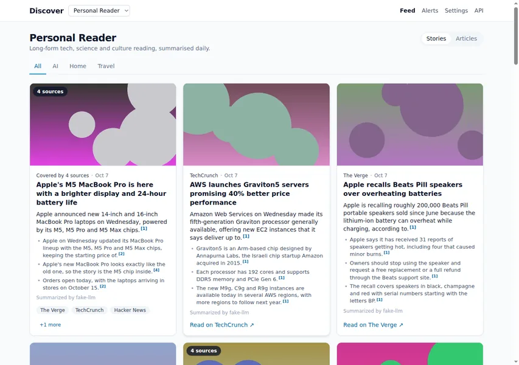

# discover-feed

A personal, "Discover-style" news-feed monitor driven by **profiles** (topics,
sources, keywords, alert rules and an OpenAI-compatible LLM endpoint). It ingests
your feeds, clusters related articles into stories, writes cited briefs and
reports with a local or cloud LLM, and can search the web for extra coverage and
background.

**Stack:** Python 3.12, FastAPI, SQLAlchemy + SQLite, APScheduler,
Jinja2 + HTMX + Tailwind (CDN). RSS/Atom ingestion and LLM summaries are both
implemented.



## Features

| Feature | What it does |
| --- | --- |
| [Sources and ingestion](features/sources.md) | RSS/Atom feeds plus Guardian, NewsData and X API adapters, budgets, OPML, catalog, health |
| [Profiles, topics and the UI](features/profiles-topics.md) | Feed tabs per profile; articles matched to topics by keyword rules |
| [Text extraction](features/text-extraction.md) | Fetches each article's page and extracts the main text (robots-aware, polite pacing) |
| [Clustering and tuning](features/clustering.md) | Groups articles into stories with TF-IDF similarity and a labelled evaluation harness |
| [Briefs and reports](features/summaries.md) | LLM-written lead + 3 bullets and a 300-550 word report, each with `[n]` citations |
| [Story Q&A](features/qa.md) | Ask follow-up questions about a story, answered only from its sources |
| [Alerts and notifications](features/alerts.md) | Keyword rules that notify via webhook, ntfy or email the moment an article lands |
| [Web-search enrichment](features/enrichment/overview.md) | Finds other publishers' coverage and adds it to under-sourced stories |
| [Background and context links](features/context/overview.md) | Adds related background reading — never same-event coverage |
| [Card images](features/images.md) | Picks, validates, caches and proxies the best image per story |
| [Authentication](features/authentication.md) | Optional read keys and an admin key for exposing the port |

## Quick start

```bash
docker compose up --build
curl localhost:8000/health
```

Then open <http://localhost:8000>. No Docker? See
[Quick start](getting-started/quick-start.md) for a local install, or run the
offline [demo](getting-started/demo.md).

## Where things live

- Docs source: `docs/` in the repository (this site is built from it).
- The README is a short front page: <https://github.com/babcoccl/discover-feed>.
- API contract: [openapi.v1.json](openapi.v1.json) (also `GET /api/v1/openapi.json`).
